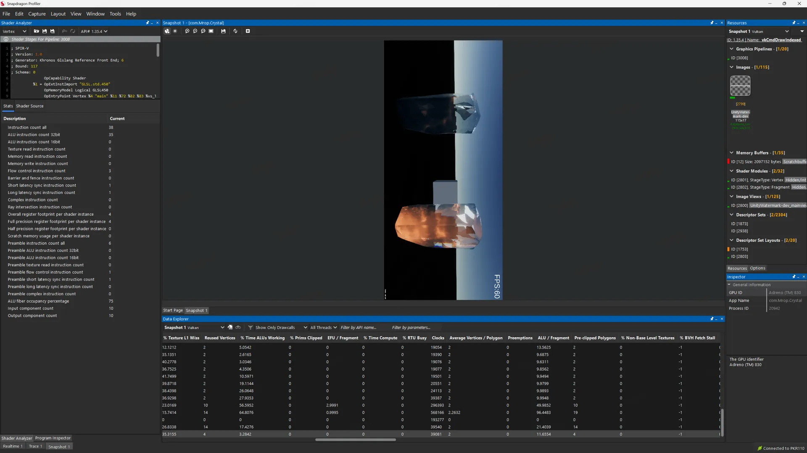
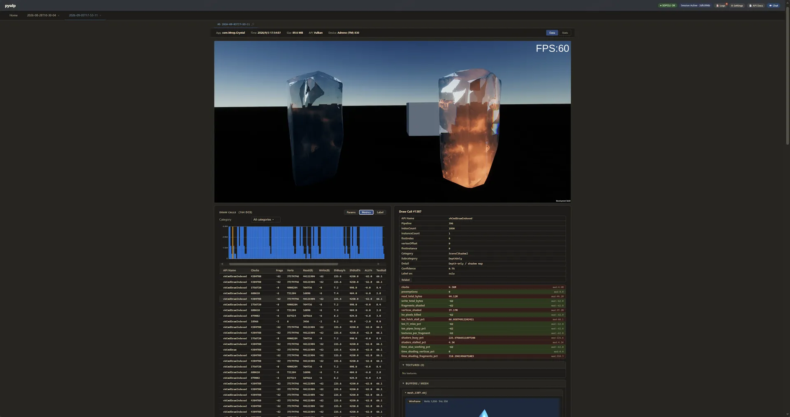
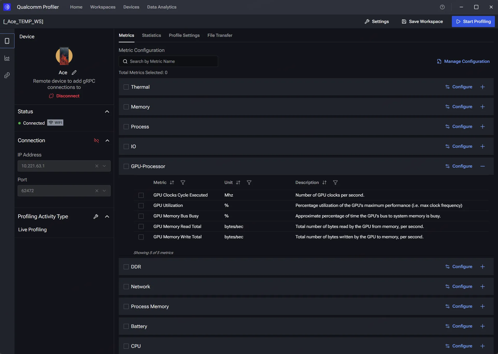

+++
date = '2026-09-03T17:00:00+08:00'
lastmod = '2026-10-19'
draft = false
title = 'Snapdragon Profiler 太难用？高通 Adreno GPU 分析工具链调研与替代之路'
tags = ['Android', 'GPU', '性能', 'CLI', 'Adreno', 'Qualcomm', 'SnapdragonProfiler', '逆向']
categories = ['图形渲染']
+++

## 当前进度：后端数据已对齐，桌面工具仍待完整验收

更新日期：2026-10-19。本文保留调研经过，并以本节和最后的待办作为当前状态。实验结论限于本机设备、应用和记录的版本组合。

**目前最实质的成果：经典截帧后端取得了一份完整捕获，42 个 Draw 的三项主要 GPU 指标，与官方 SDP GUI 对同一捕获的导出结果按四位小数完全一致。** 修复后的后端已部署；但桌面工作台对新版产物的完整操作流程、多轮误差验收仍未完成。

| 工作项 | 当前状态 | 能说明什么 |
|---|---|---|
| 经典 Snapshot 采集、解析与归档 | 已取得有效捕获，修复版已部署 | 已有可供 GUI 接入的数据后端 |
| API 与 Draw 指标归属 | 已修复本次验证路径 | 避免句柄精度损失、错配与跨 Draw 求和 |
| 同捕获 CLI / GUI 三项指标对齐 | 42 Draw × 3 指标，共 126 项通过四位小数比较 | 该捕获的导出值一致 |
| 同场景多轮、主要指标误差 ≤10% | **未完成** | 不能宣布性能测量稳定性已达标 |
| ToolsPlay 桌面工作台 | 已有采集、历史、逐 Draw 和 API 时间线界面 | 新后端与整套界面的完整验收仍待进行 |
| 官方设备侧 sdpcli 2026.8 原生崩溃 | 正常启动仍复现；有实验绕过候选 | **不能宣布根治，也不能把止崩当作指标正确** |
| 文件和入口整理 | 已明确归属并迁移主要实验文件 | 少量占用中的旧副本仍待清理 |

证据来源：本地《GPU 指标对齐调查》的“17:33 同一捕获 GUI 对照通过”记录、配对 CSV、后端部署记录及工具源码。文章末尾列出对应文件，机器路径由本篇 `context.json` 保存。

## 1 为什么要做替代工具

最初的痛点是操作往返太多：连接设备、启动应用、截帧、等待导出、整理文件，再逐 Draw 检查。部分测试组合还出现采集失败、空归档或进程退出，重复劳动多。

目标逐渐明确为：**把采集和提取做成可编排的后端，再用顺手的桌面界面查看可信数据。** 自动生成 AI 诊断报告不是这轮的核心需求。

官方 GUI 仍有价值：它是当前数据对照的重要工具。早期文章将它概括为“不要走的路”过于绝对；自建工具也复用官方组件，换一层界面不会自动消除底层故障。



## 2 几个名字相近的工具，分别负责什么

最容易混淆的是自编 Windows `SDPCLI.exe` 与高通设备侧 `sdpcli`。它们属于不同采集路线，故障和修复结论不能互相套用。

| 名称 | 定位 | 本轮如何使用 |
|---|---|---|
| 官方 Snapdragon Profiler GUI | 高通桌面分析工具 | 打开同一份捕获，导出指标作基准 |
| **SdpWorkbench：SDP 截帧工作台** | ToolsPlay 内的自建 PyQt5 桌面前端 | 日常主入口，驱动经典截帧后端 |
| 自编 `SDPCLI.exe` | 基于第三方壳逆向、修复的 C# 后端，调用官方组件 | 连接、截帧、回放、提取、指标关联与归档 |
| SdpCliExplorer：SDP CLI 探索器 | 高通设备侧 `sdpcli` 的桌面封装 | 实时采样及官方 Trace 实验 |
| pysdp | Python 分析平台与 WebUI | 历史调研平台，本轮不采用其网页作为入口 |
| Qualcomm Profiler / qprof | 另一套官方工具生态 | 保留消费机激活研究，本轮不作为主线 |

当前主线是：

```text
ToolsPlay → SDP 截帧工作台（SdpWorkbench）
                    ↓ HTTP 调用
             自编 SDPCLI.exe
                    ↓ 官方组件
              手机经典 Snapshot 采集
                    ↓
           捕获归档、逐 Draw 数据与桌面查看
```

工作台已存在，不再是“未来要写一个前端”。但“已有界面”和“最新后端已在界面端到端验收”是两件事，后者尚未完成。

## 3 主线进展：从能导出到能相信指标

### 3.1 从第三方壳获得可编程接入方式

[mysheng8/sdpcli-releases](https://github.com/mysheng8/sdpcli-releases) 提供第三方 Snapdragon Profiler CLI 的二进制发布。这个发布仓库不能作为“源码已开源”的依据。

早期通过托管代码反编译和运行观测，确认这条链路复用 `SDPClientFramework`、`SDPCoreWrapper`、`SDPCore.dll` 等官方组件。设备侧由 service、SnapshotPlayer 和经典捕获层协作完成采集，不需要自建整套通信协议。

最初修复了 command buffer 选择导致的提取不完整、资源提取并发相关崩溃，以及缺失程序集等问题。它们证明了自编后端的可行性，但并不证明所有 GPU 指标已正确。

目前使用的是**匹配验证过的一组运行库和自编后端**，已部署到项目的 `Release`，配套资产同步到 `runtime`。不能随意混用不同版本 DLL；“直接换上最新版官方 DLL 就能用”不是已验证结论。

依据：本地 `architecture.md`、`bugs.md`，以及 2026-10-19 指标对齐报告。

### 3.2 本轮修复了哪些数据问题

| 问题 | 修复内容 | 意义 |
|---|---|---|
| 新旧 API 结构布局不一致 | 适配并验证实际 SDK 的结构布局与字符串表示 | 防止 API 数据被错误解释 |
| 导入版本不匹配 | 从捕获版本信息读取版本 | 避免用错误版本参数导入 |
| 64 位无符号句柄精度损失 | Replay / Capture 句柄用十进制文本保存，拒绝不兼容的旧表结构 | SQLite 不能再把大句柄转成有损浮点数；已丢失的精度不能靠转回文本恢复 |
| Draw 与指标关联不唯一 | 根据 API 录制和提交建立映射，使用完整捕获、回放句柄、提交次数和 Draw 身份关联 | 避免把不同 command buffer 的相同局部序号混在一起 |
| 重复或冲突数据被错误合并 | 相同身份、相同值去重；冲突或缺失关系明确报错 | 不再用求和或猜测掩盖歧义 |
| 导出失败仍可能表现为成功 | 传播导入、提取错误，并清理旧指标结果 | 防止失败后展示上一次数据 |
| SDK 压缩与归档同时操作文件 | 比较复制前后文件集合、长度和修改时间，变化时重试，持续不稳定则失败 | 避免把不完整归档当作成功结果 |

当前映射验证覆盖实际使用的 primary command buffer 单次提交路径；重复提交绘制 command buffer、secondary command buffer、Submit2 等路径尚未验证，当前明确拒绝处理。**不支持时应给出原因，不能生成看似可信的数值。**

归档竞态修复有六项针对性回归；真机也实际遇到源文件在归档期间消失，重试后成功完成归档。集成构建记录为 0 errors、278 warnings，并非“零警告”。

依据：`sdpcli-alu-analysis-20261019.md` 中的 API 布局、句柄存储、映射和归档回归记录。

### 3.3 同一份捕获，与官方 GUI 对齐到了什么程度

基准捕获：`2026-10-19T17-27-58.sdp`。用户在官方 SDP GUI 中打开这一份捕获，导出 `Export_2026-10-19_17-33-43.csv`。

配对使用 command buffer 与局部 Draw 序号，检查一一覆盖、API 名称和标量绘制参数；不是将两个独立帧简单按行号对齐。

| 指标 | 对照数量 | 最大非零基准相对差异 |
|---|---:|---:|
| % Shader ALU Capacity Utilized | 42 / 42 | 0.002621677% |
| % Wave Context Occupancy | 42 / 42 | 0.000777479% |
| % Time Shading Fragments | 42 / 42 | 0.000053642% |

三项共 **126 个数值**，CLI 结果四舍五入至小数点后四位后，全部与 GUI CSV 相同。最大绝对差约为 **0.000049851632 个百分点**，符合该 CSV 的显示精度；零基准也分别核对为双方为零。

这里的 Fragment 指标是 **着色时间占比**，不是毫秒耗时。也不能把“与官方导出一致”解释为已独立证明硬件计数器本身绝对准确。

捕获 SHA-256：

```text
6464df0f410792704ef1d0863c7d0d2a9a67eb97b1b356c4028964045c5d3d0a
```

依据：`mapped-gui-comparison-2026-10-19T17-27-58.csv`、`compare_mapped_gui.py` 和同捕获 GUI 导出文件。

### 3.4 为什么还不能宣布性能验收完成

验收目标是**同场景多轮，主要指标相对 GUI 的误差 ≤10%**。现在完成的是其中的“同捕获导出一致性”，还缺多轮 GUI 基准和重复采集的统计。

此前两个独立捕获的结构匹配比较中，有一个 ALU 对照项差异约 18.45%。后续发现同参数 Draw 大量重复，绘制顺序也会变化，原先的跨帧配对不能证明唯一对应。因此既不能用它判定后端必然算错，也不能因为新的同捕获结果一致就宣布该跨轮问题消失。

后续需要固定场景、记录采集条件、取得多轮 GUI 与 CLI 数据，先确认可比的 Draw / 分组，再报告差异。不用“数值接近”代替归属正确，也不把单帧一致冒充多轮稳定。

## 4 官方设备侧 sdpcli：定位推进了，仍不是可靠替代

这一节说的是高通设备侧 `sdpcli`，不是上一节已对齐的经典 Snapshot 后端。

### 4.1 修正旧文的根因判断

2026.6 的历史现场包含 22 次同类崩溃栈：层的 fence 监控线程进入驱动，最终在 `memmove` 中越界。这个复现事实保留，但旧文将其解释为“已释放页 / UAF / 生命周期竞态”证据不足。

2026-10-19 的动态观测确认了更直接的错误：**第二路异常计数被用于计算拷贝长度，导致从约 1 MiB 的源映射尝试拷贝数 GiB 数据。** 新版调查还观察到 reset 前后第二路旧计数保留，随后参与超长拷贝。

这证明了错误长度与越界路径，尚未解释异常计数为何出现、为何没有被合法数据覆盖。UAF、同步竞态、格式或协议问题仍不能写成确定根因。时间戳链的符号差异也只是历史调查线索。

经典路径与官方 CLI 路径必须分开评价。vendor 内置层此前未测，旧文“另外两代层都稳”的表述已撤回。

依据：`rea-crash-investigation-20261019.md` 与 `sdpcli-2026.8-investigation-20261019.md`。

### 4.2 2026.8 与绕过候选

| 实验路径 | 实际观察 | 当前判断 |
|---|---|---|
| 2026.8 正常启动 | 仍复现同类越界崩溃 | 单纯升级未解决本机问题 |
| 官方暂停启动 `t s -s vk` | 最小程序及两个 Unity 新进程的多轮采集暂未崩 | 有价值的候选，有限观察不等于长期稳定 |
| reset 时初始化第二路计数 | 最小程序三轮、Unity 五轮；Unity 约 200 秒观察未复现越界 | 实验修复候选，观察窗口包含采集间隔 |
| 丢弃异常 stream | 曾取得有限存活结果 | 会损失真实样本，不作为可靠默认方案 |

初始化实验中仍出现异常 ALU 数值，且尚未闭合“reset → GPU 写入合法非零计数 → 正确收集第二路数据”的证据链。因此这些补丁**没有作为默认采集修复接入工作台**。

旧文“所有绕过都无效”“必崩”的概括不再成立；同样，新的有限成功也不足以宣称根治。

### 4.3 已经拿到数据，不代表它可以用于性能判断

本轮已保存官方 CLI 的文本和 JSON 数据。一次完整 JSON 导出约 59.6 MB，包含 9471 个 Surface，但其中 ALU 仍有大于 100 的异常值。它可用于排查数据来源，不能当作已经与 GUI 对齐的那份结果。

还定位到 JSON 追加路径的重复遍历开销，准备过加速候选；原始进程在注入前完成导出，**加速候选没有真机验证，也没有部署**。

实时采样仍是独立用途。旧版实测的 127 项指标、Trace 清单和编号都应绑定版本与设备；2026.8 的 Wave Occupancy 编号已经变化，不能跨版本只按数字 ID 套用。

## 5 桌面工具与文件归属

### 5.1 使用入口确定为 SdpWorkbench

工作台已有连接、启动、截帧、产物索引、历史会话、逐 Draw 详情、Marker 和 API 时间线等界面能力。当前修复版后端也已部署到其默认路径，但还需完成**新后端 → 分析产物 → 界面显示**的完整验收。

日常目标流程是：**打开工作台 → 选设备和应用 → 到目标场景截帧 → 查看结果**。后端启动、文件落点和历史载入应由工具处理，而不是要求用户在命令行、网页和多个实验目录间切换。

[pysdp](https://github.com/mysheng8/pysdp) 是另一个已有的 Python / WebUI 平台。本轮不采用其网页入口，误接 WebUI 的启动改动已撤回；已验证的共用后端更新保留。



### 5.2 文件已按用途归位

以下路径相对于本地工具仓库根目录；它们不是博客线上下载链接。

| 位置 | 归属 |
|---|---|
| `ToolsPlay/SdpWorkbench/` | 日常桌面前端 |
| `ToolsPlay/SdpWorkbench/_generate/workspace/` | 工作台日常捕获、分析与历史 |
| `AndroidProfile/SDPCLI_PY/SDPCLI/Release/` | 当前部署的自编后端 |
| `AndroidProfile/SDPCLI_PY/SDPCLI/runtime/` | 配套运行时资产 |
| `AndroidProfile/SDPCLI_PY/SDPCLI/_generate/` | 经典截帧证据、回归工程、构建与回滚资料 |
| `ToolsPlay/SdpCliExplorer/_generate/` | 官方 CLI / REA 调查现场 |
| `AndroidProfile/SDPCLI_QC/_doc/` | 调查报告与复现实验说明 |

经典实验主要文件已从 Explorer 迁到后端目录，相关路径已更新，实验 C# 源码从生产项目编译中排除。少量文件被进程占用，旧副本暂留原处，新位置已补齐并核对哈希；这部分清理尚未彻底结束。

## 6 qprof 路线保留为历史研究

早期在消费机上尝试激活 Qualcomm Profiler 的 `qmonitor-grpc-server`，通过共享内存兼容垫片、运行时路径处理及传输通道配置，取得服务启动与连接结果。这是特定设备和系统组合上的实验，不是通用安装方法。

当时可用指标未满足本项目目标，因此本轮优先经典 Snapshot 路线。旧文“从决策树永久删除”过于绝对，应改为**当前不投入**，不能推断所有消费机或后续版本都不可用。

共享内存返回类型、驱动计数器限制等判断也应绑定当时二进制和设备，不能推广为所有 Android 系统的行为。具体过程保留在本地 `PKR110_QualcommProfiler_Plan.md`，本文不再重复未经本轮复测的操作配方。



## 7 接下来要做什么，做到哪一步才算完成

| 顺序 | 待完成项 | 验收标准 |
|---|---|---|
| 1 | 完成 SdpWorkbench 新后端接入与操作验收 | 从桌面采集、分析到逐 Draw 显示走通；失败明确提示，不展示旧结果 |
| 2 | 简化日常操作 | 自动准备后端、保存产物、载入历史，用户无需手动搬文件 |
| 3 | 多轮 GUI / CLI 对照 | 同场景、明确对应关系、记录条件，主要指标误差 ≤10%；不达标则保留差异与原因 |
| 4 | 清理被占用的旧副本 | 确认占用释放和新归档完整后清除残留 |
| 独立研究 | 官方 sdpcli 第二路计数问题 | 证明有效样本被保留、指标正确且可重复，再考虑接入默认流程 |

当前状态可以概括为：**后端已从“能导出”推进到“同捕获三项指标与官方 GUI 一致”；接下来要把这份可信结果交付到好用的桌面流程，并补齐多轮稳定性验收。**

## 8 证据与更新记录

公开项目来源：

- [mysheng8/sdpcli-releases](https://github.com/mysheng8/sdpcli-releases)：第三方 CLI 二进制发布来源，不作为源码开源证明。
- [mysheng8/pysdp](https://github.com/mysheng8/pysdp)：Python 分析与 WebUI 平台。

本篇自有实验结论对应以下本地材料，完整路径记录在 `context.json`；原始捕获未随博客公开，外部读者不能仅靠本文独立复现实验：

| 材料 | 支撑内容 |
|---|---|
| `sdpcli-alu-analysis-20261019.md` | 指标异常调查、经典后端修复、归档回归及同捕获对齐 |
| `2026-10-19T17-27-58.sdp` + `Export_2026-10-19_17-33-43.csv` | 同捕获 CLI / GUI 原始基准 |
| `mapped-gui-comparison-2026-10-19T17-27-58.csv` | 126 项数值比较 |
| `rea-crash-investigation-20261019.md` | 2026.6 动态证据与旧 UAF 判断的更正 |
| `sdpcli-2026.8-investigation-20261019.md` | 新版崩溃、暂停启动、初始化候选与局限 |
| SdpWorkbench 源码、README 与后端源码 | 当前桌面能力、默认入口和实现范围 |
| 后端 `_generate/README.md` | 实验文件迁移与占用残留清单 |

2026-09-03 初稿保留了调研起点；2026-10-19 更新撤回未经证实的 UAF / 必崩 / 永久弃用结论，补入工作台现状、数据修复、同捕获对齐结果和未完成验收。

> **核查范围**：本次依据本地源码和实验记录修订当前进度，并复核上游仓库定位；未重跑手机采集，未将有限实验写成通用稳定性保证。
