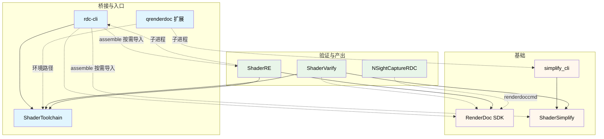
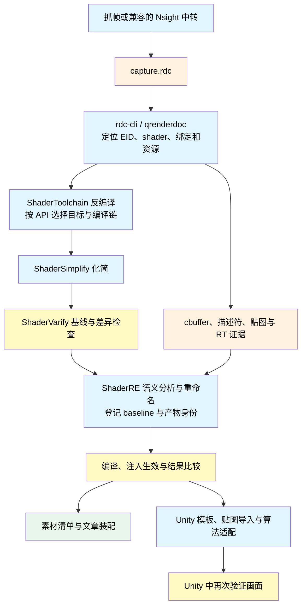

+++
title = 'RenderDoc 逆向分析工具链盘点'
date = '2026-08-12T10:00:00+08:00'
lastmod = '2026-10-13'
tags = ['RenderDoc', 'Shader', '逆向', '工具链']
+++

> 从“抓到一帧”到“理解 shader，再在 Unity 中复现”，中间需要查询、反编译、化简、验证和素材整理。这篇文章按当前本地源码盘点各工具的职责、协作方式和能力边界。

本文于 **2026-10-13** 更新。源码与引用索引记录在本文章目录的 `context.json`；文中的源码路径除另有说明外，相对 RDC 根目录。命令、pass 和规则数量以代码实测为准，给出查证入口，不延续旧版文章的固定统计。

## 先看当前工具链

RenderDoc 自身已经提供回放、管线检查、像素历史、shader 调试与编辑等能力，支持情况取决于 API 和设备。这里的工具链是在其 Replay API 之上，把重复操作、源码变换、验证与产出整理自动化。RenderDoc 的 shader 调试能力可查阅[官方源码中的使用说明](https://github.com/baldurk/renderdoc/blob/v1.x/docs/how/how_debug_shader.rst)。

当前最需要纠正的架构认识是：**旧 RenderdocMCP 已归档，rdc-cli 是当前帧分析与自动化入口**。人、脚本和 AI 都可以调用 CLI；ShaderVarify 则在自己的进程中直接加载 RenderDoc SDK。

| 部件 | 当前职责 | 入口或位置 |
|---|---|---|
| RenderDoc SDK | capture 回放、资源访问、shader 替换与调试 | `renderdoc` Python 模块 |
| ShaderSimplify | GLSL/HLSL 源码化简 | `ShaderSimplify/api.py` |
| simplify_cli | 独立解释器中的化简协议入口 | `_src/simplify_cli.py` |
| ShaderToolchain | 第三方编译/反编译工具调度、共享源码变换 | `ShaderToolchain/` |
| qrenderdoc 扩展 | GUI 内导出、绑定与调试辅助 | `%APPDATA%/qrenderdoc/extensions/`，外部目录 |
| rdc-cli | 帧查询、导出、调试、shader 替换、断言、远程会话 | `rdc-cli/`，独立 fork 仓库 |
| ShaderVarify | 化简前后回放结果比较与差异定位 | `ShaderVarify/tools/harness.py` |
| ShaderRE | 语义重命名、注入验证、素材/文章装配、Unity 模板工具 | `ShaderRE/_src/` |
| NSightCaptureRDC | 通过 C++ Capture 回放中转支持的 Nsight capture | `NSightCaptureRDC/_src/nsight_to_cpp.py` |
| BuildWHL / BuildPyi | 构建 SDK wheel 与类型存根 | `Build/BuildWHL/`、`Build/BuildPyi/` |
| RenderdocPatcher | 针对指定 RenderDoc 源码版本的改名与定向补丁 | 独立仓库，当前位于 RDC 外 |
| RenderdocMCP | 历史能力来源与追溯材料 | `_retired/RenderdocMCP_20260929/`，已归档 |

### 依赖与工作流是两种图

下面画的是**依赖方向**：箭头从消费者指向被依赖模块。实线表示直接 import；虚线表示按需/回退 import、子进程或环境依赖。依赖矩阵 auto 区由 `_src/gen_dep_matrix.py` 扫描 import 生成，manual 区手工维护；矩阵是仓库的校验入口，图仅作阅读辅助。



这不是严格单向的层级树：rdc-cli 的 assemble 能力会按需导入 ShaderRE，ShaderRE 的验证脚本又会通过子进程调用 CLI。前者只涉及对应命令，不能理解为所有 CLI 查询都需要整套产出工具。

外部 Patcher 和 SDK 构建工具不挤进这张核心依赖图。当前依赖文档仍有 Patcher 位于 RDC 内的旧路径说明；本文按实际独立仓库核查它，不把旧路径当成当前可执行入口。

### 端到端工作流

这张图的箭头表示数据和工作推进方向。验证失败应回到对应环节，不会因为生成了 HLSL 或 Unity 模板就自动完成逆向。



## ShaderSimplify：把反编译源码变得可读

ShaderSimplify 是 Python 源码化简引擎，支持 GLSL/HLSL，使用 tree-sitter 后端，**不依赖 RenderDoc**。典型变换包括常量折叠、内联、无效写入消除、swizzle 清理、GLSL/HLSL 各自支持的 normalize / smoothstep 形态还原、HLSL 的 lerp 还原，以及重复代码块提取。

这些变换识别的是实现中支持的表达式形态；发现一个数学上类似的表达式，不等于一定会触发同一 pass。

### 执行阶段与入口

引擎按 pre、convergence、post 阶段组织 pass；normalize 还在收敛前单独处理，outline 属于后处理。normalize 的 registry 标签仍是 convergence，引擎会将其提前执行，因此 metadata 标签与实际时序要分别看。收敛阶段反复执行已启用的 pass，源码稳定或达到轮数上限时退出。pass 有执行顺序；异常 pass 会警告并跳过，不能把“引擎返回了结果”直接等同于“全部变换成功且语义保持”。

进程内标准入口是 `ShaderSimplify.api.simplify_source`，ShaderVarify 使用它。纯 CLI 则由 `_src/simplify_cli.py` 取得引擎并执行。rdc-cli 的 assemble handler 仍有包级导入路径。旧版文章中“入口有几处、流水线有几份”的统计不再沿用。

在 RDC 根目录查当前 registry：

```powershell
python _src/simplify_cli.py --list-passes
```

列表包含语言、阶段、启用状态与 risky 标记，是了解当前 pass 集合的入口。

### 插件为什么需要独立进程

qrenderdoc 的内嵌 Python 环境与化简引擎所用解释器不同。插件通过 `ShaderToolchain/simplify_subprocess.py` 调独立 Python，避免在 GUI 进程中直接加载 tree-sitter 等依赖。

协议是 **stdin 首行 JSON 配置，余下内容为源码；stdout 输出化简源码**。失败信息写 stderr，并以非零退出码返回。插件可用 `RDC_PY312` 指定解释器；未指定时封装会尝试查找。这里的 `simplify_subprocess` 是调用方封装，`simplify_cli` 是被调用的独立进程入口。

源码依据：`ShaderSimplify/SimplifyEngine.py`、`SimplifyHLSL_AST.py`、`SimplifyGLSL_AST.py`、`api.py` 与 `_src/simplify_cli.py`。

## ShaderToolchain：统一工具调用与共享变换

ShaderToolchain 集中管理工具发现、stage 名翻译、参数构造和部分调用封装；DX 反编译入口另有直接 subprocess 调用。它不 import ShaderSimplify 引擎；化简由独立进程协议连接。

| 工具或模块 | 实际用途与边界 |
|---|---|
| spirv-cross / `spirv_cross.py` | SPIR-V → HLSL、GLSL 或 JSON 反射 |
| glslangValidator / `compilers.py` | 回编译 SPIR-V 的一个后端 |
| dxc / `compilers.py` | `-spirv` 路径编译 HLSL → SPIR-V；其他调用方也用 dxc 编译 DXIL |
| fxc / `compilers.py` | SM5 HLSL 编译、汇编输出等本地检查 |
| spirv-dis | SPIR-V 反汇编 |
| HLSLDecompiler / `dx_decompile.py` | 接收 DXBC 或 DXIL 字节，直接调用外部 exe 返回 HLSL |
| dxbc2dxil、dxil-spirv | 已注册的外部工具路径；注册本身不代表高层入口逐步调用它们 |
| `shader_rename.py` | 基于 RenderDoc reflection 的资源与变量重命名 |
| `simplify_subprocess.py` | 反编译/化简相关封装与独立进程化简通道 |
| `bindless_heap.py` | 无界数组与 SM6.6 descriptor heap 索引相关的源码变换和特征判断 |

### 路径发现不是统一三段式

环境变量有最高优先级，但各工具还有专用探测路径。例如 spirv-dis 会查 Vulkan SDK，dxc 会查 LOCALAPPDATA/Vulkan SDK，fxc 会查 Windows Kits，HLSLDecompiler 会查包内和插件目录。这些探测可能先于 PATH，最后才轮到配置默认值。

现有环境变量包括 `SPIRV_CROSS_PATH`、`GLS_VALIDATOR_PATH`、`DXC_PATH`、`FXC_PATH` 等，具体工具和解析顺序以 `toolchain.py` 的 registry 与 `get_tool_path` 为准。

### 编译目标必须区分

`compile_to_spirv` 的 dxc 后端会加 `-spirv`，并按 stage 选择 SM6 profile；`compile_to_dxbc` 使用 fxc 的 SM5 profile。URP 的 dxc 预检又是另一条路径，不能只看到“dxc”就断言输出一定是 SPIR-V。

DX 反编译的 Python 高层入口实际调用 `HLSLDecompiler.exe`，以 `-dxbc` 或 `-dxil` 指定输入形式。当前这段 Python 源码没有显式编排“dxbc2dxil → dxil-spirv → spirv-cross”；exe 内部实现不能用这段调用代码代替证据。

反编译参数也要按目的选：验证链尽量减少额外变换；阅读与导出链可能启用重命名或不同 shader model。**反编译成 HLSL 不代表可无条件重新编译并替换原 shader**，绑定、输入布局、编译目标和浮点行为都需要检查。

源码依据：`ShaderToolchain/toolchain.py`、`compilers.py`、`spirv_cross.py`、`dx_decompile.py`、`shader_rename.py`、`bindless_heap.py`。

## rdc-cli：当前帧分析与自动化入口

本地 rdc-cli 是 BANANASJIM/rdc-cli 的 fork。它采用 Click 客户端和 TCP JSON-RPC daemon；daemon 持有 ReplayController，需要 capture 数据的命令通过 RPC 查询或操作回放。输出形式包括 TSV、JSON、trace 和导出文件。

### 先用源码版，并管理好会话

当前 fork 的 MROP handler 会查找 RDC monorepo 的 `_doc/dependency-chain.md` 锚点，再加载 `_src.bootstrap`。因此这里使用**源码版 `uv run rdc`**；单独 pip 安装的 site-packages 快照不能代表这套工作树，且可能缺少 monorepo 锚点。

以下示例在 RDC 的 `rdc-cli` 目录执行。capture、EID、资源 ID 与坐标均需替换成自己的输入：

```powershell
uv run rdc doctor
uv run rdc --session article open .\capture.rdc
uv run rdc --session article info
uv run rdc --session article events
uv run rdc --session article draws
uv run rdc --session article goto 123
uv run rdc --session article pipeline --json
uv run rdc --session article bindings --json
uv run rdc --session article descriptors 123
uv run rdc --session article close
```

具名 session 用来区分独立回放会话，后续每条命令要使用同一名字。普通本地会话的 `close` 会请求关闭自己的 daemon；连接外部 daemon 的会话默认只撤销本地连接状态，显式 `--shutdown` 才请求关闭外部 daemon。旧流程图“普通 close 一律留下 daemon”的说明已不适用。

当前还有 remote、Android、`--proxy` 回放和 `--connect` / `--listen` 连接模式，具体参数查对应 `--help`。它们解决捕获与回放位置的问题，不能替代 shader 的 API 兼容性验证。

### 查询、导出、调试与替换

| 需求 | 代表命令 |
|---|---|
| 找 draw / shader | `events`、`draws`、`shaders`、`shader-map`、`shader-eids` |
| 看管线、绑定、参数 | `pipeline`、`bindings`、`descriptors`、`cbuffer` |
| 看资源与虚拟路径 | `resources`、`resource`、`ls`、`cat`、`tree` |
| 导出素材 | `texture`、`rt`、`buffer`、`manifest-export` |
| shader 调试 | `debug pixel`、`debug vertex`、`debug thread`、`debug compare` |
| 编辑回放 | `shader-build`、`shader-replace`、`shader-restore` |
| 自动检查 | `validate`、`assert-pixel`、`assert-clean`、`assert-count`、`assert-state` |
| 一次性原型 | `script`：在 daemon 内 exec Python，直接使用 controller/rd/state |

`debug compare EID_A EID_B X Y` 分别跑两个 draw 的 DebugPixel，对比输出与变量值。编译器分配的寄存器可能不同，因此同名变量比较和跨寄存器同值匹配都只是诊断线索，要结合指令和 shader 变体解释。

`validate` 是 event、pixel、resource、vertex-output、cbuffer、capture 等完整性检查，其中部分使用独立 API 路径比对。它不等同于 ShaderVarify 的化简正确性检查，也不等同于 ShaderRE 的产物注入验证。

### 从旧 MCP 迁来的核心能力

`decompile-shader` 支持 SPIR-V / DXBC / DXIL。SPIR-V 路径可选 HLSL/GLSL，DX 路径只支持 HLSL；当前化简默认开启，失败会显式报错。stage 参数使用 `pixel` 等长名：

```powershell
uv run rdc --session article decompile-shader --stage pixel --event 123 --target hlsl --simplify -o .\pixel.hlsl
uv run rdc --session article manifest-export (Resolve-Path .\manifest.json).Path
uv run rdc --session article debug pixel 123 640 360 --trace
uv run rdc --session article debug compare 123 456 640 360
uv run rdc --session article validate event --event 123
```

`manifest-export` 要求绝对 manifest 路径，示例用 Resolve-Path 从本地相对路径解析；manifest 及其中的输出目录必须能在 daemon 所在机器访问，远程模式需按服务端路径准备。

`assemble-shader` 从指定 draw 的 VS/PS 出发，当前 handler 只处理 SPIR-V 字节路径，借 ShaderSimplify 与 ShaderRE 模板组装 Unity shader。它不是任意 DX shader 到 Unity 的通用转换器。

完整命令面查 `uv run rdc --help` 和各子命令 `--help`，本地生成参考位于 `src/rdc/_skills/references/commands-quick-ref.md`。上述示例核对的是当前 Click 参数，本文更新没有重新跑 capture/GPU。

源码依据：`rdc-cli/src/rdc/cli.py`、`commands/mrop/`、`handlers/mrop/`、`handlers/debug.py` 与 `services/session_service.py`。

## qrenderdoc 扩展与已归档 MCP

### GUI 侧仍有用途

当前本机 extensions 目录可见 ExportConstantsBuffer、BindlessUsage、PixelDebugPrompt、DrawcallTimer、FrameAnalyzer、NvPerfAnalyzer、RDCUtils 与 renderdoc_mcp_bridge 等目录。**目录存在不代表已启用或与当前 SDK 全部兼容**。

ExportConstantsBuffer 的 ImageExport / ShaderExport 提供贴图、buffer、输出与 shader 导出相关操作；ShaderExport 的 GenerateUtils 委托 ShaderToolchain，并通过独立解释器做化简。插件适合交互选中、导出和查看；CLI 适合留命令记录和批处理。

不能仅凭功能相似就断言所有能力都经历了“插件 → MCP → CLI”的统一迁移。当前能确认的是，CLI 的部分 MROP handler 来自历史 MCP，插件和 CLI 各自仍有对应实现。

### RenderdocMCP 的位置

旧服务在 `_retired/RenderdocMCP_20260929/`。它是历史实现与能力来源，当前依赖扫描和运行时不加载它。源码里保留的迁移注释、旧 README 或 `renderdoc_mcp_bridge` 目录，都不能作为旧服务仍在运行的证据。

旧版文章的 MCP 工具数量、工具分组与独立服务层已移除。当前分析入口查 rdc-cli，当前验证入口查 ShaderVarify。

## ShaderVarify：化简正确性检查

ShaderVarify 直接加载 RenderDoc SDK，并调用 ShaderSimplify 与 ShaderToolchain。它把“capture 本身的回放变化”“反编译/重编译变化”“化简引入的变化”分开观察。

### texture、pixel、debug 证明的事情不同

| 模式 | 检查方式 | 主要边界 |
|---|---|---|
| `texture` | 保存回放、重注入、builtin、simplified 输出；按网格分块逐像素比较 | 网格用于分块，不能把网格数量当成采样点数；覆盖范围依实际输出与网格尺寸 |
| `pixel` | PickPixel 采样原始、builtin、simplified | 快验；不执行 texture 模式完整的原始字节码重注入自检 |
| `debug` | 按 only / disable 等模式分析 pass 影响 | 用于缩小问题范围，结论仍依赖所用比较路径 |

texture 模式先检查两次未注入重放，再检查原始字节码重注入，随后比较 builtin 与 simplified。量化图像的网格按输出尺寸连续划分，块内遍历全部像素；pixel 模式才是坐标采样，默认使用网格中心点，给 seed 后使用随机采样。输出、坐标与覆盖范围会影响结论。

```text
texture 路径
原始回放 ↔ 再次回放              → 重放稳定性
原始回放 ↔ 原始字节码重注入      → 注入保真度
原始回放 ↔ builtin              → 反编译/回编译变化
builtin ↔ simplified           → 化简变化
```

### verdict 与容差

| 结果 | 应怎样理解 |
|---|---|
| `INJECT_ERROR` / `INJECT_MISMATCH` | 注入失败或原始字节码重注入存在差异 |
| `INJECT_FIDELITY_LIMITED` | 满足实现中的重放噪声/差异阈值条件，不能当成无条件完全一致 |
| `DECOMPILE_MISMATCH` | 反编译/重编译链没有达到相应比较标准 |
| `COMPARE_FAIL` | builtin 与 simplified 比较失败，需要定位变换或编译差异 |
| `PASS` | 本模式实际执行的检查在当前样本和阈值下通过 |

当前配置有量化比较容差，也有 float RT 的绝对/相对容差、texture 模式的差异占比与视觉尺度判断。旧文“一切统一容差 4”“PNG 大小差超过某值就一定语义错误”“固定几倍速”的说法不再保留。PNG 文件大小不是像素正确性的裁决依据。

### API 与 Compute 支持

SPIR-V 与 Native DX 有不同反编译/回编译链。Native DX 路径包含输入布局、循环递增、buffer layout 和循环 idiom 等修复；Vulkan 的 HLSL 路径还需要处理 IO location 与 descriptor set / space 映射。

Compute 的 texture 模式可检查 UAV：纹理输出走图像比较，buffer 输出保存原始字节并比较。PickPixel 路径仅适用于纹理 UAV，不能用它验证 buffer UAV。

在 RDC 根目录运行，参数中的 capture 和 EID 换成实际输入：

```powershell
python ShaderVarify/tools/harness.py texture --rdc .\capture.rdc --event 123 --language hlsl --backend treesitter
python ShaderVarify/tools/harness.py pixel --rdc .\capture.rdc --event 123 --samples 300 --seed 42
python ShaderVarify/tools/harness.py debug --rdc .\capture.rdc --event 123 --mode disable --pixel --samples 200 --seed 42
```

### 无 GPU 检查的边界

golden 测试比较化简源码和预期文本，不需要 GPU 或 RenderDoc；它能发现 pipeline 输出漂移，不能证明回放像素一致。`bench_simplify.py` 做独立计时，但需要源码输入。

`quick_verify.py` 仍需 capture/RenderDoc，只做编译检查；`profile_timing.py` 也需要打开 capture。**“不渲染”不能一概写成“不需要 RenderDoc 或 GPU 环境”。**

源码依据：`ShaderVarify/_src/shader_verify.py`、`rd_capture.py`、`pixel_compare.py`、`renderdoc_runtime.py`、`tools/harness.py` 与 `tests/test_golden.py`。

## ShaderRE：语义、产物身份与验证闭环

ShaderRE 现在覆盖语义重命名、可读版生成、转述辅助、注入验证、资源语义清单和文章装配。Unity 移植工具只是其中一部分。

### 项目脚本只保留配置，机械核心集中维护

`new_proj.py` 生成 `proj/<project>/` 骨架、`project.json` 和项目配置脚本。项目里的 `rename_semantic.py` / `make_readable.py` 是映射与配置入口，机械实现集中在：

- `_src/rename_engine.py`：成员、数组、访问表达式、资源等重命名。
- `_src/readable_engine.py`：可读版重建。
- `_src/transcribe.py`：转述分段与装配辅助。
- `_src/project_context.py` / `project_manifest.py`：项目、baseline 与验证产物身份。

反射重命名尝试利用已有 reflection 名称；**语义重命名**则需要 cbuffer 原始值、绑定、描述符、资源名、shader 运算和贴图/RT 内容互相印证。资源名只是证据之一，不能把“看到名字”写成“已经确认用途”。

当前模板除 MEMBER / ARRAY / ACCESS / RESOURCE / CBUFFER 映射外，还支持 `BUF_NORMALIZE` 和 `LANE_RENAMES` 等配置。映射要对应当前 baseline 的访问形式和编号，不能从另一份重新反编译的源码直接照搬。

### baseline 哈希防止验证错文件

新项目生成后，先将选定的 baseline 保存到项目的 `_generate/`，再登记。以下命令在 RDC 根目录执行，`demo` 和文件路径换成自己的项目；`--file` 相对当前工作目录解析，不会自动相对 `--proj`：

```powershell
python ShaderRE/_src/new_proj.py demo
python ShaderRE/_src/project_manifest.py baseline record --proj demo --eid 123 --stage ps --file .\ShaderRE\proj\demo\_generate\baseline.hlsl
python ShaderRE/_src/project_manifest.py baseline check --proj demo --eid 123 --stage ps --file .\ShaderRE\proj\demo\_generate\baseline.hlsl
```

记录以 **EID + stage + SHA-256** 关联到 `project.json`，后续检查会拒绝未登记或哈希变化的 baseline。验证记录还保存 report、baseline、target 和可选 source 的路径/哈希；开始验证时先记录 BLOCKED，再按实际结果更新。

这解决“拿另一份 simplified.hlsl 做对照”“源码变了但还引用旧报告”等问题。哈希闭合证明文件身份一致，GPU 是否正确仍由对应验证执行证明。

### 注入必须先证明真的生效

当前 `verify_inject.py` 不再把“采样零差异”直接当成成功。它会使用 canary 正对照扰动输出，确认替换能产生可观测变化，再比较**注入后的 baseline 与目标**；还读取回放日志中的 PSO 重建失败信息。

没有替换生效证据时，零差异可能只是 shader 没有真正被替换，结果会是 BLOCKED。输入 DXBC 二进制时，需要对应的 `--canary-source` 才能构造正对照。运行参数包括必填 `--proj`、`--eid`、`--compare`；采样宽高、编译 profile 和容差也要按目标设置，不沿用旧图的固定屏幕/采样点假设。

| 目标路径 | 对应工具与约束 |
|---|---|
| D3D11 / DXBC | `build_dxbc.py`、`verify_inject.py --dxbc`；二进制与源码来源要可追溯 |
| D3D12 Pixel / DXIL | `verify_inject.py --dxil`；profile 必须匹配所需特性 |
| D3D12 Compute / 纹理 UAV | `verify_inject_compute.py` 检查注入输出；`gate_dxil.py` 辅助比较归一化编译反汇编 |
| Vulkan / SPIR-V | ShaderVarify 的 SPIR-V 编译/注入路径 |

`bindless_heap.py` 可辅助把反编译的声明式无界数组恢复为 SM6.6 `ResourceDescriptorHeap` / `SamplerDescriptorHeap` 访问。**无界描述符表与直接 heap 索引不同**，要结合原 DXIL 特征判断，不能看到“bindless”就自动转换。

下面的图只表达通用闭环；每个 API 的完整命令查当前脚本 `--help` 和 ShaderRE 的 `shader-reverse-engineering` 技能。



### 从素材证据到文章

`init_article_semantics.py` 根据选定 EID 的描述符与 RT 素材生成 `article_semantics.json` 骨架：RT 和纹理有不同默认选取策略，名称与内容不会自动推断。缺失的语义要由分析补齐。

`gen_article_bundle.py` 根据项目、EID、语义清单和素材装配文章包；`--check` 检查 DDS、sidecar、导出清单、正文引用，以及验证产物的哈希/来源是否闭合。

装配检查**不会重跑 GPU，也不普遍要求所有记录状态都是 PASS**。它验证的是证据链完整性；报告中的 FAIL、BLOCKED 或受限结果仍应在文章中如实说明。

`proj/` 中素材、shader、报告和项目文章留在本地工作树，不加入 RDC 的 Git。通用脚本和技能才属于工具仓库的维护范围。

源码依据：`ShaderRE/_src/new_proj.py`、`rename_engine.py`、`readable_engine.py`、`project_context.py`、`verify_inject.py`、`verify_inject_compute.py`、`gen_article_bundle.py`。

## Unity / URP：模板能省搬运，算法适配仍需人完成

`ToUnity/AssembleShader.py` 解析 HLSL 结构和标记，把片段填进指定 Unity 模板。它能减少重复装配，不能自动恢复原引擎的数据来源、光照环境、材质关键字、坐标空间和渲染状态。

| 工具或模板 | 当前实际输出 |
|---|---|
| `URP/export_textures.py` | 导出指定 draw 的 PS 绑定贴图；非 float / float 分别走 TGA / EXR，并写 `texture_info.json` |
| `URP/fix_texture_meta.py` | 按贴图清单设置 mip、sRGB、尺寸和平台格式；不限于 BC7/BC6H |
| `URP/gen_unity_shader.py` | 生成 Properties 与 CBUFFER 文本，供粘贴/装配到 shader |
| `URP/urp_verify_fxc.py` | 使用 URP/Core include 环境做 fxc 编译检查 |
| `URP/urp_verify_dxc.py` | 使用对应 include 环境做 dxc 预检 |
| `URP/Template/*.cs` | ShaderRT 编辑器窗口、材质赋值与贴图导入设置模板，部分依赖 Odin |

这些是可移植的脚本与模板，不是已经在所有 Unity 项目安装的统一应用。编译通过只是第一道检查；还要在 Unity 中核对实际材质、变体、绑定、空间约定与最终画面。

源码依据：`ShaderRE/_src/ToUnity/AssembleShader.py`、`ToUnity/URP/` 与 `PORT_TO_UNITY.md`。

## 抓帧中转与独立 Patcher

### NSightCaptureRDC

工具读取 Nsight capture metadata，寻找匹配的 Nsight 版本，Generate C++ Capture，再编译生成的工程，通过 RenderDoc 捕获回放。它不是直接把任意 Nsight 文件转码为 RDC，也不意味着 Nsight 支持而 RenderDoc 不支持的 API 特性会自动变得可回放。

本地流程要求匹配 capture 的 Nsight 版本。Vulkan 工程在编译前修复 `VulkanReplay.cpp` 中 VMA buffer device address allocator flag 的条件判断；D3D12 不做这项修复。回放工作目录要包含工程的数据文件，捕获入口使用 `renderdoccmd capture`。

版本说明需要区分官方与本地经验：本地文档对 D3D12 中转采用 2025.5 的保守流程；[NVIDIA 2026.1 官方 Release Notes](https://archive.docs.nvidia.com/nsight-graphics/2026.1/ReleaseNotes/index.html) 将 D3D12 / Vulkan C++ Capture 列为 deprecated，说明将来移除，不能据此说该版本已经统一移除。后续[官方 Release Notes](https://docs.nvidia.com/nsight-graphics/ReleaseNotes/index.html) 也有 Vulkan C++ Capture 的弃用提示。具体 capture 是否还能导出，仍要核对对应版本和实际输出。

源码依据：`NSightCaptureRDC/_src/nsight_to_cpp.py` 与该项目的 `nsight-to-rdc` 技能。

### RenderdocPatcher

Patcher 是位于 RDC 外的独立 Git 仓库，本机源码位置记录在 `context.json`。它对特定上游源码版本执行字符串、代码块和注入相关的定向修改，并对编译二进制中的残留特征做后处理。

不能把它描述为“清除所有 RenderDoc 特征”或通用反作弊绕过方案。规则依赖上游源码文本，换 tag 后要重新核验；版本跟随的维护约定也不代表当前本地每个新版本都已验证兼容。

规则与操作入口以独立仓库的 `_src/renderdoc_patcher.py`、`_bat/` 和 `--help` 为准。原文固定规则数、旧 bat 编号和旧 RDC 内路径不再作为当前操作指南。

## SDK 环境、构建工具与根目录胶水

### SDK ABI 与发现路径

当前本机 rdc-cli 的 `.python-version` 钉在 **3.12**，生效 RenderDoc SDK 位于 `C:/Program Files/RenderDoc/`，本机 `renderdoc.pyd` 按 Python 3.12 ABI 构建。这是本机约束，不能推成 rdc-cli 的通用最低版本。

`discover.find_renderdoc()` 先尝试 bare import，再检查候选目录并做子进程探测；候选包括环境变量、系统安装目录和 `renderdoccmd` 同目录。本机不用设置 `RENDERDOC_PYTHON_PATH`。GUI 内嵌 Python 和 CLI SDK 环境要分别处理，避免 GUI 的扩展模块抢占 CLI 标准库。

ShaderVarify 的路径解析与 runtime 加载是另一条实现，可通过 `RENDERDOC_MODULE_PATH` 指定 SDK 目录。不能把不同消费者的环境变量混写成统一安装步骤。

### BuildWHL 与 BuildPyi

这是旧文章遗漏的当前支撑工具：

- **BuildWHL**：从 RenderDoc 源码构建 Python 模块与 DLL，验证导入，再组装 wheel；源码、缓存、目标 Python 和 stubs 可通过参数选择。
- **BuildPyi**：通过匹配版本的 RenderDoc `docs/stubgen.py` 生成类型存根；qrenderdoc 存根从同版本 GUI 的 pystubs 导入。

源码在 `Build/BuildWHL/_src/build_rdoc.py` 与 `Build/BuildPyi/_src/generate_stubs.py`。默认路径和本地源码缓存可能滞后，开始构建前查脚本参数与目标版本，不能把默认值当成本机最新环境。wheel 构建/安装也不意味着所有 daemon 已切换到新 SDK。

### 仓库胶水与查证入口

| 文件 | 职责 |
|---|---|
| `_src/bootstrap.py` | RDC 根定位、路径注入与 SDK 路径解析辅助 |
| `_src/gen_dep_matrix.py` | 扫描 import，生成/校验依赖矩阵 auto 区 |
| `_doc/dependency-chain.md` | 依赖矩阵与组织说明 |
| `ShaderRE/_src/shader_re_doctor.py` | 按分析/重命名/文章任务检查所需环境与入口 |

读源码时也要区分“注册了某工具”“某路径有 fallback”“运行中成功加载”这几个层次。矩阵捕捉 import 关系，不能替代 GPU、外部工具或独立仓库的实际验证。

## 怎样选择工作流

| 当前目标 | 建议入口与终点 |
|---|---|
| 只想看某 draw 的资源和参数 | rdc-cli / qrenderdoc 查询、导出 |
| 只想拿到可读源码 | decompile-shader；输出可阅读不等于可注入 |
| 修改化简 pass | golden 文本回归 → ShaderVarify 对指定 capture 的比较 |
| 做语义重命名/转述 | ShaderRE 登记 baseline → 改写 → 按 API 编译和注入验证 |
| 写分析文章 | 补语义与证据 → gen_article_bundle 装配/检查 → 说明报告适用范围 |
| 移植 Unity | 前述证据和 shader → ToUnity/URP 模板工具 → Unity 内画面核对 |
| capture 只能经 Nsight 获得 | 先确认版本与 C++ Capture 能力，再用 NSightCaptureRDC 中转 |

这套工具的边界已经从“GUI / MCP / CLI 三种入口并行”收敛为：**rdc-cli 负责读帧与自动化，ShaderToolchain 负责外部工具与共享变换，ShaderSimplify 负责源码化简，ShaderVarify 与 ShaderRE 分别检查化简链和产物链**。生成文件、编译通过、采样通过和最终画面复现，是不同阶段的结果，应分别保留证据。

> **📋 事实核查**：本文于 2026-10-13 按 fact-check-report 对照当前本地源码更新，同步修订依赖图、流程图与 context.json。命令示例经参数定义核对；本次未重跑 capture/GPU，不能把历史实测或本文更新当成当前帧的验证报告。
